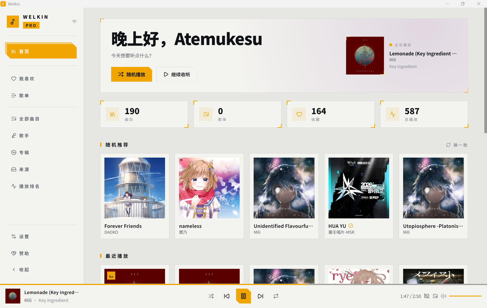
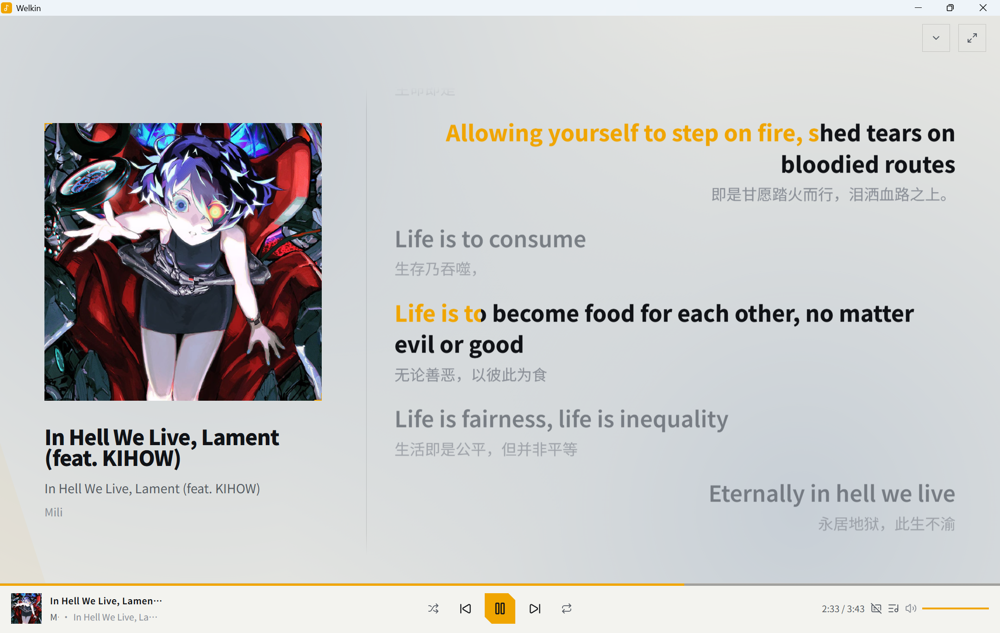
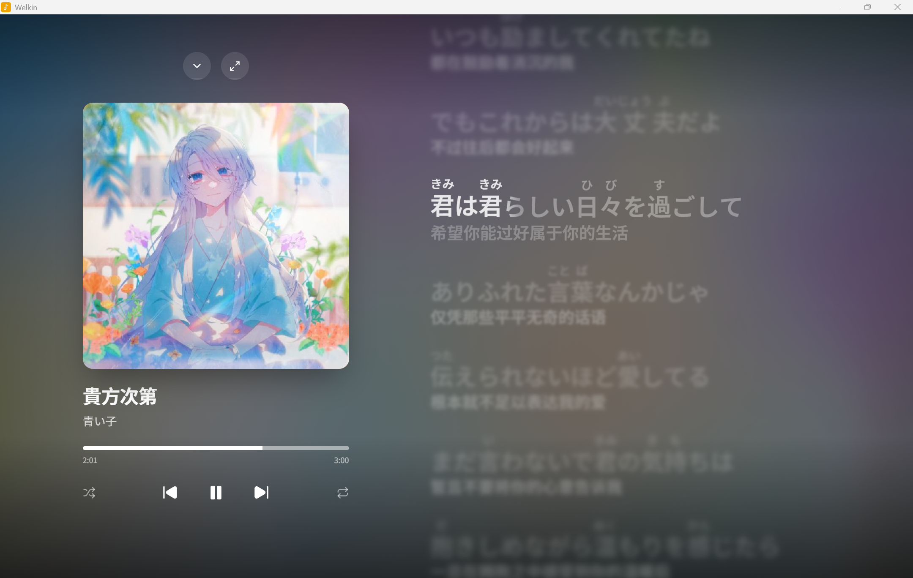

**[中文](README.md) · [English](README.en.md)**

# Welkin

A cross-platform music player built with [Tauri 3](https://v3.tauri.app/). It reads your music collection over WebDAV or from local folders, syncs your profile, playlists and playback progress across devices, and provides AMLL word-by-word lyrics, a desktop lyrics overlay, and system media controls. Audio is decoded and played entirely in the Rust backend; the frontend only handles the UI and the play queue. Linux uses CEF (Chromium) as its webview runtime; Windows, macOS and Android use the system webview.

- Website: <https://welkin.atemukesu.com>
- Repository: <https://github.com/atemukesu/WelkinPlayer>
- Platforms: Windows / macOS / Linux / Android
- Languages: 简体中文, English

## Screenshots






## Features

- **Music sources**: Configure multiple WebDAV and local-folder sources at once; pick one as the cloud sync location.
- **Lyrics**: AMLL word-by-word rendering; online lyrics fetched in order from QQ Music, NetEase Cloud Music and the AMLL lyrics library; same-named local lyrics win.
- **Desktop lyrics overlay**: A separate transparent lyrics window (a system overlay on Android).
- **System media controls**: Windows SMTC, macOS Now Playing, Linux MPRIS, Android MediaSession.
- **Rust playback engine**: Symphonia decoding and cpal output (WASAPI / CoreAudio / ALSA on desktop, Oboe / AAudio on Android); WebDAV streams play as they download with accurate seeking, prefetching based on network state, with manual caching.
- **Cross-device sync**: Nickname, playlists, favorites and playback progress sync to the chosen source.
- **Library management**: Read and edit metadata/cover art; playback statistics and rankings.
- **Themes**: Light/dark and multiple accent colors.

## Tech stack

| Layer | Technology |
| --- | --- |
| Shell & backend | Tauri 3 (Rust) |
| Audio engine | [rodio](https://github.com/RustAudio/rodio) + [cpal](https://github.com/RustAudio/cpal) + [Symphonia](https://github.com/pdeljanov/Symphonia) (Rust decoding and output) |
| Frontend | Vue 3 + TypeScript + Vite |
| State / i18n | Pinia, vue-i18n |
| Styling | Tailwind CSS 4 |
| Lyrics rendering | [@applemusic-like-lyrics](https://github.com/amll-dev/applemusic-like-lyrics) |
| Updates | tauri-plugin-updater (desktop) |

## Requirements

- Node.js 20+ and [pnpm](https://pnpm.io/) 9
- Rust stable (rustup)
- Platform dependencies:
  - Windows: WebView2 (bundled with Windows 11)
  - macOS: Xcode Command Line Tools
  - Linux: `libgtk-4-dev`, `libx11-dev`, `libxkbcommon-dev`, `libnss3-dev`, `libasound2-dev`, `libgbm-dev`, `patchelf` (the first build downloads the CEF runtime)
- For Android builds: JDK 17, Android SDK, Android NDK (r26b), and the Android Rust targets

## Development

```bash
pnpm install        # install dependencies

pnpm tauri dev      # run the full desktop app (Rust + frontend HMR)
pnpm dev            # frontend only (Vite, port 1420)
```

## Build

```bash
pnpm build                     # frontend only (includes vue-tsc type check)
pnpm tauri build               # desktop installers

pnpm tauri android build --apk # Android APK
```

> Android release signing is injected via environment variables: `ANDROID_KEYSTORE_PATH`, `ANDROID_KEYSTORE_PASSWORD`, `ANDROID_KEY_ALIAS`, `ANDROID_KEY_PASSWORD`. It falls back to debug signing when unset.

## Project structure

```
.
├─ src/                 # Vue frontend
│  ├─ views/            # Pages (settings, sources, lyrics editor, ...)
│  ├─ stores/           # Pinia stores
│  └─ lib/              # Shared utilities and frontend contracts
├─ src-tauri/           # Rust backend
│  ├─ src/playback/     # Playback engine (decoding, audio output, transport)
│  ├─ src/streaming/    # Stream and manual caches
│  ├─ src/commands/     # Tauri commands (media, WebDAV, updates, ...)
│  ├─ gen/android/      # Android project
│  └─ tauri.conf.json   # App config (version, updater, ...)
├─ scripts/             # Build helper scripts
└─ .github/workflows/   # CI (release pipeline)
```

## Roadmap

> Last updated: v1.4.0-rc.1 (November 2026). This is a living plan for what Welkin does next and why. Priorities will shift with user feedback, upstream Tauri 3 progress and maintenance cost; version numbers are targets, not delivery promises.
>
> The two series can progress in parallel; version numbers indicate the primary focus, not a strict release schedule.

### Legend

- [x] Done
- [ ] Planned

### Principles

- **Local-first**: Your library and profile stay on your own WebDAV or disk. No account system, no telemetry.
- **Playback stays in Rust**: Decoding, output, DSP and the queue remain in the backend, so music keeps playing when the webview is hidden or stalled.
- **No paywall on core features**: Pro is a thank-you perk (splash and badge). Playback, sync, lyrics and other essentials stay free.
- **Stability before surface area**: Experimental features are clearly labelled and can be switched off. Every release prioritises reliability fixes.

### Now: v1.4.x — Stability and polish

#### Smart transitions

- [x] Ship smart transitions as experimental (v1.4 RC)
- [ ] Handle tracks with unknown duration
- [ ] Handle very short tracks
- [ ] Handle tracks without a detectable beat
- [ ] Reuse analysis caches when the plan changes
- [ ] Allow manual overrides of the inferred order
- [ ] Name the release that ends the experimental period

#### Sync

- [x] Conflict resolution for edits to the same field on two devices (v1.4)
- [ ] Show the last sync time
- [ ] Show the number of pending operations
- [ ] Show failure reasons
- [ ] Retry offline edits automatically
- [ ] Make conflict prompts easier to read
- [ ] Recover from sync failures without a restart

#### WebDAV

- [ ] Conditional requests (ETag / Last-Modified)
- [ ] Resume interrupted scans
- [ ] Progress and timing feedback for large libraries

#### Playback

- [ ] Fix output-device hot-plug regressions
- [ ] Fix Bluetooth and audio-focus regressions
- [ ] Seek and track-end handling for remote streams with unknown duration

#### Platform and engineering

- [ ] Move to stable Tauri 3
- [ ] Unify upgrade paths on Windows / macOS / Linux / Android
- [ ] CI: run Rust tests on every PR
- [ ] CI: run frontend type checks and builds on every PR
- [ ] CI: Android / Linux smoke builds
- [ ] CI: release artifact verification

### Mixing series: v1.5 → v1.6 — From automatic transitions to live mixing

> Building on the existing smart transitions, dual-deck crossfades and BPM / key analysis, this series turns "automatic planning" into a hands-on mixing workflow.

#### v1.5 · Dual decks and manual mixing

- [ ] A/B dual-deck performance view
- [ ] Crossfader
- [ ] Independent gain per deck
- [ ] 3-band EQ per deck
- [ ] Live waveforms and playheads
- [ ] Beat-grid display and manual correction
- [ ] Drag transition in/out points
- [ ] Adjust blend length and curves
- [ ] A/B auditioning of a transition
- [ ] Instant undo for transitions
- [ ] Hot cues
- [ ] Memory cues
- [ ] Beat loops / rolls aligned to bars
- [ ] Independent tempo / pitch per deck
- [ ] Master tempo
- [ ] Sync
- [ ] Mark bass handover, filter switches and remaining beats on the waveform

#### v1.6 · FX, stems and recording

- [ ] Per-deck filter
- [ ] Per-deck delay
- [ ] Per-deck reverb
- [ ] Beat FX
- [ ] Send amount and wet/dry control
- [ ] Per-deck loudness matching
- [ ] Limiting and clipping protection
- [ ] Evaluate local stems: vocals / drums / bass / other
- [ ] Evaluate stem model size and memory use
- [ ] Evaluate stem performance on mobile
- [ ] Record live mixes
- [ ] Export WAV / FLAC
- [ ] Preserve deck, FX and automation timelines
- [ ] Export transition plans for reuse
- [ ] Generic MIDI controller mapping
- [ ] HID / keyboard mapping
- [ ] Support common DJ controllers
- [ ] Cache BPM, key, beat grid and cue points
- [ ] Sync mixing data across devices

### Plugin series: v1.7 → v1.8 — Turn capabilities into pluggable extensions

> Keep the core small and stable: sources, lyrics, external stats / scrobbling, visualizations and UI capabilities move into plugins instead of piling every integration into the main app.

#### v1.7 · Plugin runtime and extension points

- [ ] WASM sandboxed plugin runtime
- [ ] Support plugins compiled from Rust
- [ ] Support plugins compiled from JS
- [ ] Manifest-based permission model
- [ ] Network access off by default
- [ ] File access off by default
- [ ] Extension point: music sources
- [ ] Extension point: lyric providers
- [ ] Extension point: scrobbling
- [ ] Extension point: visualizers
- [ ] Extension point: themes
- [ ] Extension point: player UI slots
- [ ] Extension point: audio DSP (evaluate realtime latency)
- [ ] Install plugins
- [ ] Update plugins
- [ ] Disable plugins
- [ ] Roll back plugins
- [ ] Show permissions, version and author
- [ ] Isolate plugin crashes
- [ ] Never hand WebDAV passwords to plugins
- [ ] Isolate plugin credentials
- [ ] SDK and type definitions
- [ ] Example plugins
- [ ] Debug logs
- [ ] Local hot reload

#### v1.8 · Official plugins and distribution

- [ ] Subsonic / Navidrome plugin
- [ ] Jellyfin / Emby plugin
- [ ] Last.fm / ListenBrainz plugin
- [ ] Visualizer plugins
- [ ] Theme packs
- [ ] Install from local files
- [ ] Install from Git
- [ ] Signed plugin registry with a version index (evaluation)
- [ ] Signature checks
- [ ] Permission-change prompts
- [ ] Auditable plugin list
- [ ] DSP / effects / analyzers as mixing-chain nodes

### Ongoing maintenance (not a separate release theme)

- [ ] Global search
- [ ] Listening history
- [ ] Playback stats
- [ ] Accessibility
- [ ] Localization
- [ ] Linux / Android distribution and updates

### Exploring (not committed)

- [ ] Mobile feasibility and model distribution for local stem separation
- [ ] LAN remote control
- [ ] Multi-device jam sessions
- [ ] Collaborative playlists
- [ ] CUE / DSD support
- [ ] iOS client
- [ ] Community governance and signing policy for a plugin registry

### Not planned

- A hosted account system or official cloud sync service (conflicts with local-first).
- A built-in music catalog, downloads, or sources that bypass copyright.
- Video playback and podcasts (we stay focused on music).
- Putting core features behind a paid edition.

### Shape the roadmap

- Open a feature request on GitHub Issues with the use case, current workaround and expected behaviour.
- Add a 👍 to existing issues to help prioritise.
- Join the QQ group `1109689488`, or support development via Afdian.

## License

Licensed under the [GNU General Public License v3.0 only](https://www.gnu.org/licenses/gpl-3.0.html) (`GPL-3.0-only`). See [LICENSE](LICENSE).
