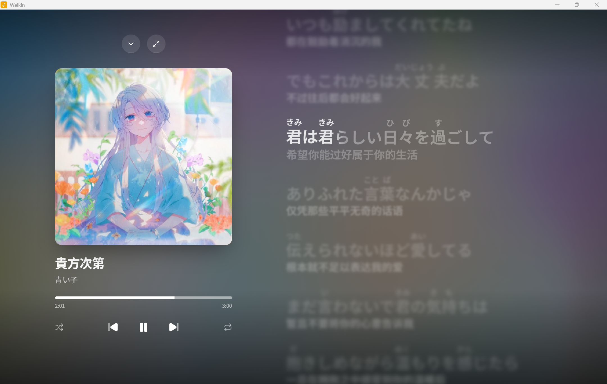

**[中文](README.md) · [English](README.en.md)**

# Welkin

基于 [Tauri 3](https://v3.tauri.app/) 的跨平台音乐播放器。通过 WebDAV 或本地文件夹读取音乐收藏，把资料、歌单与播放进度跨设备同步，并提供 AMLL 逐字歌词、桌面悬浮歌词与系统媒体控制。

- 官网：<https://welkin.atemukesu.com>
- 仓库：<https://github.com/atemukesu/WelkinPlayer>
- 支持平台：Windows / macOS / Linux / Android
- 界面语言：简体中文、English

## 截图




## 功能特性

- **音乐来源**：同时配置多个 WebDAV 与本地文件夹来源，可指定其中一个作为云端同步位置。
- **歌词**：AMLL 逐字歌词渲染、支持在线获取歌词。
- **桌面悬浮歌词**：独立的透明歌词窗口。
- **系统媒体控制**：Windows SMTC、macOS Now Playing、Linux MPRIS、Android MediaSession。
- **跨设备同步**：昵称、歌单、收藏、播放进度等同步到指定来源。
- **音乐管理**：元数据/封面读取与编辑、播放统计与排名。
- **主题**：浅色/深色与多种主题色。

## 技术栈

| 层 | 技术 |
| --- | --- |
| 壳与后端 | Tauri 3（Rust） |
| 音频引擎 | [rodio](https://github.com/RustAudio/rodio) + [cpal](https://github.com/RustAudio/cpal) + [Symphonia](https://github.com/pdeljanov/Symphonia)（Rust 解码与输出） |
| 前端 | Vue 3 + TypeScript + Vite |
| 状态/i18n | Pinia、vue-i18n |
| 样式 | Tailwind CSS 4 |
| 歌词渲染 | [@applemusic-like-lyrics](https://github.com/amll-dev/applemusic-like-lyrics) |
| 更新 | tauri-plugin-updater（桌面） |

## 环境要求

- Node.js 20+ 与 [pnpm](https://pnpm.io/) 9
- Rust stable（rustup）
- 平台依赖：
  - Windows：WebView2（Win11 自带）
  - macOS：Xcode Command Line Tools
  - Linux：`libgtk-4-dev`、`libx11-dev`、`libxkbcommon-dev`、`libnss3-dev`、`libasound2-dev`、`libgbm-dev`、`patchelf`（首次构建会自动下载 CEF 运行时）
- 构建 Android 额外需要：JDK 17、Android SDK、Android NDK（r26b）、Android 目标 Rust 组件

## 开发

```bash
pnpm install        # 安装依赖

pnpm tauri dev      # 启动完整桌面应用（Rust + 前端热更新）
pnpm dev            # 仅启动前端（Vite，端口 1420）
```

## 构建

```bash
pnpm build                     # 仅构建前端（含 vue-tsc 类型检查）
pnpm tauri build               # 构建桌面安装包

pnpm tauri android build --apk # 构建 Android APK
```

## 目录结构

```
.
├─ src/                 # Vue 前端
│  ├─ views/            # 页面（设置、来源、歌词编辑等）
│  ├─ stores/           # Pinia 状态
│  └─ lib/              # 通用工具与前端契约
├─ src-tauri/           # Rust 后端
│  ├─ src/playback/     # 播放引擎（解码、音频输出、传输命令）
│  ├─ src/streaming/    # 流缓存与手动缓存
│  ├─ src/commands/     # Tauri 命令（媒体、WebDAV、更新等）
│  ├─ gen/android/      # Android 工程
│  └─ tauri.conf.json   # 应用配置（版本、更新器等）
├─ scripts/             # 构建辅助脚本
└─ .github/workflows/   # CI（发布流程）
```

## 待办

#### 播放
- [x] Equalizer: 均衡器
- [ ] 音量归一化
- [ ] 混响 (Reverb)、延迟 (Delay)、回声 (Echo)、合唱 (Chorus)、镶边 (Flanger)

#### 智能过渡

- [x] 智能过渡实验性上线（v1.4 RC）
- [ ] 改善过渡效果和稳定性

#### 平台与开发

- [x] CI/CD: 为 Arch Linux 生成构建产物

#### 扩展系统
- [ ] 安装 .zip 的主题包
- [ ] 主题包：结构定义 & 解析 & 开发模式热重载
- [ ] 安装 .js 的音源插件
- [ ] 音源插件：js 解析
- [ ] 音源插件：支持稀疏索引 
- [ ] 长期规划中：安装 wasm 插件 

### 参与路线图

- 在 GitHub Issues 提出功能请求，说明使用场景、现有替代方案与期望行为。
- 给已有 issue 点赞，帮助判断优先级。
- 加入 QQ 群 `1109689488`，或通过爱发电支持开发。

## 许可证

本项目基于 [GNU General Public License v3.0 only](https://www.gnu.org/licenses/gpl-3.0.html)（`GPL-3.0-only`）发布，详见 [LICENSE](LICENSE)。


## 有关 AI 生成的声明

本软件的代码使用 AI 辅助生成。